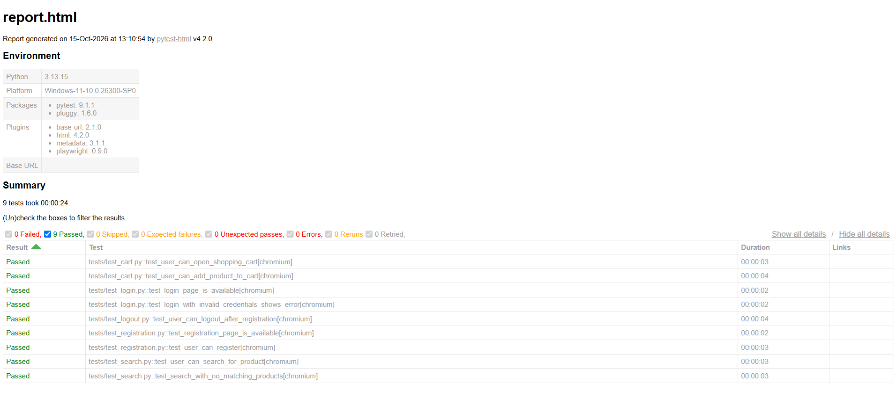

# Web Shop Playwright Automation

UI test automation project for the [Tricentis Demo Web Shop](https://demowebshop.tricentis.com/).

## Tech Stack

- Python
- Playwright
- Pytest
- pytest-html
- Page Object Model (POM)
- Git and GitHub

## Test Coverage

The project includes automated UI tests covering the following areas:

### Login

- Verify that the login page is available.
- Verify validation for invalid login credentials.

### Registration

- Verify that the registration page is available.
- Register a new user with a unique email address.

### Product Search

- Search for products by keyword.
- Verify the search results.
- Verify the message displayed when no products match the search.

### Shopping Cart

- Open the shopping cart.
- Configure a product and add it to the cart.
- Verify the success notification and cart quantity.

### Logout

- Register a new user and verify that logout works.

## Test Results

Latest recorded test run: **9 passed, 0 failed**.

### Test Report Screenshot



The full HTML report is available in [`reports/report.html`](reports/report.html). Download the file and open it in a browser to inspect the test results.

## Project Structure

```text
web-shop-playwright-automation/
├── pages/
│   ├── __init__.py
│   ├── login_page.py
│   ├── home_page.py
│   ├── product_page.py
│   ├── cart_page.py
│   ├── checkout_page.py
│   └── register_page.py
├── tests/
│   ├── test_cart.py
│   ├── test_checkout.py
│   ├── test_login.py
│   ├── test_logout.py
│   ├── test_registration.py
│   └── test_search.py
├── utils/
│   └── __init__.py
├── reports/
│   └── report.html
├── screenshots/
│   └── test-report.png
├── conftest.py
├── pytest.ini
├── requirements.txt
├── .gitignore
└── README.md
```

## Installation

Clone the repository:

```bash
git clone https://github.com/Vlady057/web-shop-playwright-automation.git
cd web-shop-playwright-automation
```

Create and activate a virtual environment on Windows:

```powershell
python -m venv .venv
.\.venv\Scripts\Activate.ps1
```

Install dependencies and Chromium:

```powershell
pip install -r requirements.txt
playwright install chromium
```

## Run Tests

Run the complete test suite:

```powershell
pytest
```

Run a specific test module:

```powershell
pytest tests/test_login.py -v
```

## Generate an HTML Report

```powershell
New-Item -ItemType Directory -Force reports
pytest --html=reports/report.html --self-contained-html
```

Open `reports/report.html` in a browser to review the results.

## Design

The project follows the Page Object Model (POM) design pattern. Page classes contain locators and reusable UI actions, while test modules contain test scenarios and assertions.

Playwright's `page` fixture provides browser-page access. Pytest is used to organize and execute tests, and Playwright assertions verify the expected UI behavior.

Registration tests generate unique email addresses to avoid conflicts with existing accounts.
